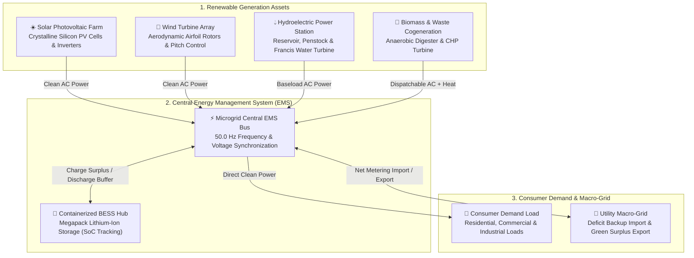
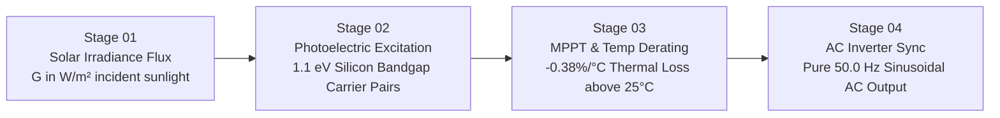
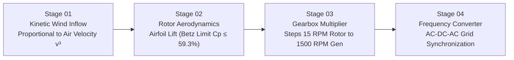
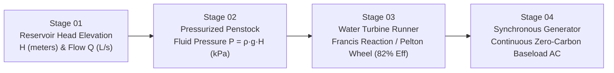
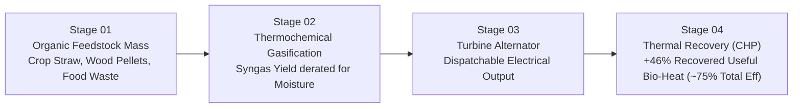
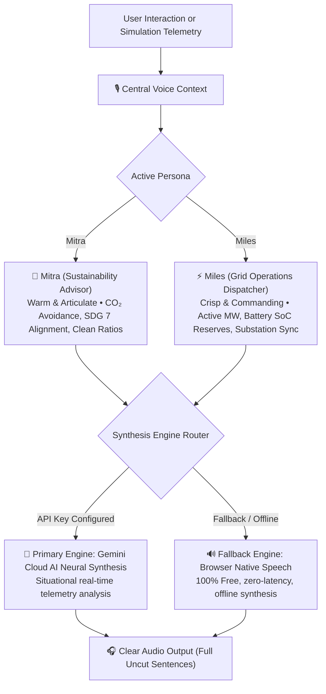

# GreenPulse — Sustainable Energy Transition (SET) Platform

> **An industrial-grade, physics-accurate Renewable Energy Simulation, 3D Digital Twin, and AI Voice Studio built to accelerate the United Nations Sustainable Development Goal 7 (SDG 7: Affordable and Clean Energy).**

---

## 🛠️ Technology Stack

<p align="left">
  
  
  
  
</p>

| Domain | Technology | Version | Purpose |
| :--- | :--- | :---: | :--- |
| **UI Framework** | React + Vite | 19 / 8 | Fast, modern client-side SPA architecture |
| **3D Graphics** | Three.js + WebGL | 0.185 | Interactive 3D Digital Twin campus & asset rendering |
| **Animation** | GSAP + Framer Motion | 3.15 / 14 | Particle flows, page transitions & pipeline animations |
| **Charting** | Recharts | 3.10 | Area, Bar, Donut, Radar analytics charts |
| **Smooth Scroll** | Lenis | 1.3 | Buttery-smooth page scrolling |
| **Routing** | React Router DOM | 7 | Client-side navigation (8 routes) |
| **Icons** | Lucide React | 1.53 | Clean SVG icon set |
| **Counters** | React CountUp | 6.5 | Animated KPI number transitions |
| **Styling** | Vanilla CSS | — | Custom Eco-Obsidian design system & glassmorphism |
| **AI Voice** | Gemini API | — | Cloud neural speech synthesis for AI personas |
| **Linting** | OxLint | 1.81 | Fast Rust-based linter |
| **Language** | JavaScript (JSX) | ES2024 | No TypeScript; `@types/react` installed as devDep |

---

## 🚀 Live Demo

> **Deployed Application:** [🔗https://set-visulizer-mopec-ldce.vercel.app/](https://set-visulizer-mopec-ldce.vercel.app/)

---

## 🧭 System Architecture & Energy Flow



---

## 📖 What We Built & Why (Plain Language)

### The Problem
Most renewable energy simulators are static calculators or black-box spreadsheets. They show a number for "Solar" or "Wind", but never explain **how electricity actually gets generated**, **what physical laws apply**, or **where energy is lost**.

### Our Solution
**GreenPulse** transforms complex energy science into an intuitive, visual, and explainable experience:
- **Interactive Multi-Stage Physics**: Visualizes the exact mechanical, chemical, and electrical stages of 4 renewable sources.
- **Real-Time 3D Digital Twin**: Lets users inspect an industrial clean energy campus in 3D WebGL with live turbine rotations, day/night cycles, and camera presets.
- **AI-Powered Voice Studio**: Enables hands-free audio briefings narrated by two specialized AI personas (**Mitra** and **Miles**) via the Gemini API.
- **Real Weather & Location Data**: Fetches live weather and solar irradiance data via external APIs to enrich simulation defaults.
- **Eco-Obsidian Design System**: Replaces dull blue interfaces with high-contrast obsidian carbon (`#070b12`), frosted glass, and vibrant nature-coded accents.

---

## 🔬 Point-by-Point Feature Breakdown & Physical Conversion Flows

### 1. ☀️ Solar Photovoltaic (PV) Simulation Engine



* **What It Is**: A simulation of crystalline silicon solar panel performance under changing sunlight and temperature conditions.
* **Why We Built It**: Real solar panels lose efficiency when they heat up, and solar output changes dynamically with angle and sunlight intensity.
* **How It Works (Step-by-Step)**:
  1. **Solar Irradiance ($G$)**: Sunlight hits panels with radiant energy ($200\text{--}1200\text{ W/m}^2$).
  2. **Photoelectric Carrier Excitation**: Photons with energy above $1.1\text{ eV}$ knock electrons free, creating Direct Current ($DC$).
  3. **MPPT & Thermal Derating**: Maximum Power Point Tracking optimizes voltage and current, while thermal loss derates power by $-0.38\%$ for every degree Celsius above $25^\circ\text{C}$ (Standard Test Conditions).
  4. **AC Inverter Grid Sync**: Pure sine-wave inverters convert filtered DC to synchronized $50\text{ Hz}$ Alternating Current ($AC$).
* **Governing Formula**:
  $$P(t) = \text{Capacity}_{\text{STC}} \times \left(\frac{G}{1000}\right) \times [1 - 0.0038 \times (T_{\text{cell}} - 25)] \times \eta_{\text{inv}}$$

---

### 2. 💨 Wind Aerodynamic Turbine Simulation Engine



* **What It Is**: An aerodynamic simulation of industrial wind turbines operating under varying atmospheric wind velocities.
* **Why We Built It**: Wind power does not scale linearly — power is proportional to the **cube of wind speed ($v^3$)**, and turbines must protect themselves in storms.
* **How It Works (Step-by-Step)**:
  1. **Kinetic Wind Inflow**: Moving air mass carries power proportional to $v^3$.
  2. **Rotor Lift & Betz Limit**: Airfoil blades generate lift and torque. Aerodynamic physics limits maximum capture to $59.3\%$ (Betz Limit).
  3. **Gearbox Multiplier**: Multiplies low rotor speed ($12\text{--}18\text{ RPM}$) up to $1500\text{ RPM}$ to drive the alternator.
  4. **AC-DC-AC Conversion**: Variable frequency AC is rectified to DC, then inverted to clean $50\text{ Hz}$ microgrid AC.
* **4 Operational Aerodynamic States**:
  - **Standby / Idle** ($< 3\text{ m/s}$): Below cut-in speed; insufficient torque to overcome friction.
  - **Active Generation** ($3\text{--}12\text{ m/s}$): Power scales cubicly; active yaw aligns with wind.
  - **Rated Full Generation** ($12\text{--}25\text{ m/s}$): Peak rated power maintained via pitch feathering.
  - **Emergency Storm Brake** ($> 25\text{ m/s}$): Mechanical disk brakes engaged to protect structural integrity.
* **Governing Formula**:
  $$P_{\text{wind}} = \frac{1}{2} \times \rho_{\text{air}} \times A_{\text{rotor}} \times v^3 \times C_p$$

---

### 3. 💧 Hydroelectric Power Station Simulation Engine



* **What It Is**: A hydraulic simulation modeling water reservoir elevation, penstock fluid dynamics, and hydro turbine electricity generation.
* **Why We Built It**: Hydropower provides continuous, dispatchable zero-carbon baseload energy that stabilizes renewable microgrids.
* **How It Works (Step-by-Step)**:
  1. **Hydraulic Head ($H$) & Flow Rate ($Q$)**: Elevated water holds gravitational potential energy. Intake valves meter volumetric water flow.
  2. **Penstock Pressure Conduit**: Static head creates high column pressure ($P = \rho \cdot g \cdot H$) channeled down the penstock.
  3. **Turbine Runner**: High-velocity water jets impart momentum to Francis reaction or Pelton runner blades, converting fluid momentum to shaft torque.
  4. **Synchronous Generator**: Couples mechanical shaft rotation to a synchronous AC generator, supplying steady baseload electricity.
* **Governing Formula**:
  $$P_{\text{hydro}} = \eta_{\text{total}} \times \rho_{\text{water}} \times g \times Q \times H$$
  *(where $\rho = 1000\text{ kg/m}^3$, $g = 9.81\text{ m/s}^2$)*

---

### 4. 🌿 Biomass & Waste Cogeneration (CHP) Engine



* **What It Is**: A circular bioeconomy and thermal cogeneration model converting organic agricultural and municipal waste into electricity and clean heat.
* **Why We Built It**: Diverting organic waste avoids methane emissions from landfills while providing dispatchable Combined Heat & Power (CHP).
* **How It Works (Step-by-Step)**:
  1. **Feedstock Selection**: Selectable categories: **Agricultural Straw** ($4.2\text{ kWh/kg}$), **Wood Pellets** ($4.8\text{ kWh/kg}$), and **Municipal Organic Waste** ($2.6\text{ kWh/kg}$).
  2. **Moisture Derating**: The engine calculates Net Lower Heating Value ($LHV$) based on moisture content:
     $$LHV_{\text{net}} = LHV_{\text{dry}} \times (1 - \text{Moisture}) - 0.68 \times \text{Moisture}$$
  3. **Gasification & Combustion**: Thermochemical gasification ($850^\circ\text{C}$) produces syngas driving a turbine alternator.
  4. **Combined Heat & Power (CHP)**: Flue-gas heat exchangers recover $+46\%$ of thermal energy for community district heating, lifting overall system efficiency to over $72\%$.

---

### 5. 🎙️ AI-Powered Voice Studio & Copilot



* **What It Is**: An intelligent audio debriefing studio featuring two specialized AI copilot personas powered by the **Gemini API**.
* **Why We Built It**: Operators and students can listen to situational microgrid debriefs without taking their eyes off the 3D twin or charts.
* **Key Capabilities**:
  - **Mitra**: Focuses on ecological impact, carbon offset milestones, and UN SDG 7 scorecard progress.
  - **Miles**: Focuses on electrical engineering, generation megawatts, battery State of Charge, and dispatch loads.
  - **Fail-Safe Architecture**: Gemini cloud AI neural synthesis as primary engine with automatic instant fallback to the browser's native speech synthesizer.
  - **Guaranteed Full Responses**: Generates complete thoughts and sentences without mid-sentence truncation.

---

### 6. 🌐 3-Way Interactive Simulator Cockpit

* **3D Digital Twin Viewport (Three.js)**:
  - Real-time 3D models for all assets: tilted solar tables, rotating wind turbines, hydroelectric penstock, biomass digester dome, and BESS storage with live LED status indicators.
  - Procedural road networks, realistic lighting (Daylight, Golden Hour Sunset, Night operations), and HTML5 Fullscreen mode.
  - 5 Instant Camera Presets: **Overview**, **Solar PV**, **Wind Farm**, **BESS Hub**, and **Hydro & Bio**.
* **2D Animated Energy Flow Schematic (GSAP)**:
  - Dynamic animated energy flow between generators, the Energy Management System (EMS), battery storage, and consumer demand.
  - **Click-to-Inspect**: Clicking any source node immediately opens that source's physics pipeline.
* **Physics Process Simulator (`GenerationProcessViewer`)**:
  - Deep-dive 4-stage pipeline with interactive sliders for solar irradiance, cell temp, wind speed, hydraulic head height, water flow rate, biomass feedstock type, and moisture content.
* **Interactive Eco-Sphere** (`InteractiveEcoSphere`):
  - A Three.js globe visualization showcasing global renewable energy adoption and SDG metrics interactively.

---

### 7. 🌍 Real-World Data Services

* **Weather & Location Service**: Fetches real-time weather data and automatically detects user location to pre-fill simulation defaults with realistic local conditions.
* **Solar Data Service**: Integrates with solar irradiance APIs to provide geographically accurate insolation data for the simulator.
* **Real Data Context** (`RealDataContext`): Centralized React context that manages live API data and exposes it to all simulator components.
* **Custom Hook** (`useRealConditions`): A clean abstraction hook consuming live weather/solar data and mapping it into simulation parameter format.

---

### 8. 🎨 The "Pristine Eco-Obsidian" Theme

* **Design Philosophy**: Replaced dull, muddy blue backgrounds with an ultra-clean **Eco-Obsidian Carbon & Frosted Glass** visual language:
  - **Background**: Deep carbon obsidian (`#070b12` / `#0c121d`) with zero blue glare.
  - **Surfaces**: Frosted glass panels (`rgba(11, 16, 26, 0.82)`) with crisp hairline borders (`rgba(255, 255, 255, 0.08)`).
  - **Nature-Coded Glowing Accents**:
    - ☀️ **Solar**: Luminous Golden Amber (`#f59e0b`)
    - 💨 **Wind**: Aero Kinetic Cyan (`#06b6d4`)
    - 💧 **Hydro**: Glacier Aquamarine (`#0ea5e9` / `#2dd4bf`)
    - 🌿 **Biomass**: Living Eco Emerald (`#10b981`)
    - 🔋 **Battery**: Neon Violet / Lime (`#8b5cf6` / `#22c55e`)
    - ⚡ **Grid**: High-Contrast Alert Coral (`#ef4444`)

---

## 🚀 Getting Started

### Prerequisites
- Node.js (v18 or higher recommended)
- npm or yarn

### Installation
```bash
# 1. Clone repository
git clone https://github.com/Vinay-vaja/SET_project.git

# 2. Navigate to project root
cd SET_project

# 3. Install dependencies
npm install
```

### Environment Configuration (Optional)
Create a `.env` file in the root directory to configure cloud intelligence features:
```env
VITE_GEMINI_API_KEY=your_gemini_api_key_here
```
*(If no API key is provided, GreenPulse automatically falls back to the native offline browser speech engine!)*

### Running Locally
```bash
npm run dev
```
Open [http://localhost:5173](http://localhost:5173) in your browser.

### Building for Production
```bash
npm run build
```

---

## 📁 Project Directory Structure

```
SET_project/
├── public/                             # Static brand assets & vector logos
│   ├── favicon.ico / favicon.png       # App icons (multiple formats)
│   ├── favicon.svg                     # SVG favicon
│   ├── apple-touch-icon.png            # iOS home screen icon
│   ├── logo.png / logo-icon.png        # Brand logos
│   ├── hero-landscape.jpg              # Hero background image
│   └── icons.svg                       # SVG icon sprite
│
├── Project Report/                     # Academic project documentation
│   └── Greenpulse-Sustainable_Enery_Transition.pdf
│
├── src/
│   ├── main.jsx                        # React DOM root entry point
│   ├── App.jsx                         # Router + layout shell + AnimatePresence
│   ├── App.css                         # App-level styles
│   ├── index.css                       # Full global design system (CSS variables,
│   │                                   # tokens, utilities, glassmorphism, etc.)
│   │
│   ├── context/                        # Global React Contexts
│   │   ├── EnergyContext.jsx           # Central state: params, simulation results,
│   │   │                               # liveResults (useMemo), runSimulation fn
│   │   ├── VoiceContext.jsx            # Speech synthesis & AI persona management
│   │   └── RealDataContext.jsx         # Live weather & solar API data context
│   │
│   ├── data/                           # Static datasets & constants
│   │   ├── energyConstants.js          # DEFAULT_PARAMS, CO2_FACTORS, calorific
│   │   │                               # values, hydrogen constants, SDG weights
│   │   ├── sdgData.js                  # SDG goal metadata (labels, descriptions)
│   │   └── technologies.js             # Emerging tech catalog
│   │
│   ├── hooks/                          # Custom React Hooks
│   │   └── useRealConditions.js        # Hook: maps live weather/solar → sim params
│   │
│   ├── services/                       # External API integration layer
│   │   ├── locationService.js          # Browser geolocation & reverse geocoding
│   │   ├── weatherService.js           # Real-time weather data fetching
│   │   ├── solarDataService.js         # Solar irradiance API integration
│   │   └── realDataService.js          # Unified real-world data orchestrator
│   │
│   ├── utils/                          # Calculation engines (pure functions)
│   │   ├── solarCalculations.js        # Irradiance, PV effect & temp derating
│   │   ├── windCalculations.js         # Betz limit, air density & turbine power curve
│   │   ├── hydroCalculations.js        # Hydraulic head, flow rate & Francis turbine
│   │   ├── biomassCalculations.js      # Feedstock LHV, moisture & CHP cogeneration
│   │   ├── batteryCalculations.js      # Round-trip efficiency & SoC limits
│   │   ├── sdgScore.js                 # Multi-criteria SDG 7/9/11/12/13 scoring
│   │   ├── auditCalculations.js        # Energy audit math + recommendation engine
│   │   ├── hydrogenCalculations.js     # Green/grey/blue hydrogen economics
│   │   ├── wasteCalculations.js        # Waste-to-energy conversion math
│   │   └── geminiVoiceService.js       # Gemini API speech & text generation client
│   │
│   ├── components/                     # Reusable UI & visualization components
│   │   ├── Navbar.jsx                  # Top navigation bar (glassmorphic, 8 links)
│   │   ├── KPICard.jsx                 # Metric display card with animated number
│   │   ├── AnimatedNumber.jsx          # React CountUp wrapper
│   │   ├── SliderInput.jsx             # Labeled range slider for simulator params
│   │   ├── EnergyFlowDiagram.jsx       # SVG/Canvas animated energy flow schematic
│   │   ├── DigitalTwin3D.jsx           # Three.js 3D scene (40KB — largest file)
│   │   ├── GenerationProcessViewer.jsx # 4-stage physics conversion pipeline viewer
│   │   ├── InteractiveEcoSphere.jsx    # Three.js globe: global SDG & energy map
│   │   ├── SDGScoreRing.jsx            # Circular progress ring for SDG scores
│   │   ├── VoiceAssistantWidget.jsx    # Mitra & Miles AI Voice Studio widget
│   │   └── simulation/                 # Per-source simulation sub-views
│   │       ├── SimulationViewport.jsx  # Container & switcher for simulation views
│   │       ├── SolarSimulationView.jsx # Solar physics deep-dive interactive view
│   │       ├── WindSimulationView.jsx  # Wind physics deep-dive interactive view
│   │       ├── HydroSimulationView.jsx # Hydro physics deep-dive interactive view
│   │       └── BiomassSimulationView.jsx # Biomass CHP deep-dive interactive view
│   │
│   └── pages/                          # Route-level page components (8 routes)
│       ├── Dashboard.jsx               # Overview: KPIs, donut chart, 24h/7d charts
│       ├── Simulator.jsx               # Main simulator: sliders + 3D twin + results
│       ├── EnergyAudit.jsx             # Equipment energy auditor + recommendations
│       ├── Compare.jsx                 # Side-by-side scenario comparison
│       ├── SDGImpact.jsx               # SDG 7/9/11/12/13 scores + radar chart
│       ├── EmergingTech.jsx            # Emerging clean energy technologies showcase
│       ├── WasteToEnergy.jsx           # Waste-to-energy circular economy calculator
│       └── About.jsx                   # Platform info & team page
│
├── index.html                          # Vite HTML entry point
├── vite.config.js                      # Vite + React plugin configuration
├── package.json                        # Dependencies & npm scripts
├── .oxlintrc.json                      # OxLint rules (Rust-based linter)
├── PROJECT_ANALYSIS.txt                # Detailed internal code analysis report
└── .gitignore                          # Standard ignore (node_modules, dist, etc.)
```

---

## 🗺️ Application Routes

| Route | Page | Description |
| :--- | :--- | :--- |
| `/` | Dashboard | Executive KPI overview, energy mix donut, 24h & 7-day charts, flow diagram, SDG rings |
| `/simulator` | Simulator | Main feature: configure all params via sliders, run simulation, inspect 3D twin & what-if solar analysis |
| `/energy-audit` | EnergyAudit | Add equipment list, get consumption analysis & efficiency saving recommendations |
| `/compare` | Compare | Side-by-side configuration scenario comparison |
| `/sdg-impact` | SDGImpact | SDG 7/9/11/12/13 scores, radar chart, before/after baseline impact comparison |
| `/emerging-technologies` | EmergingTech | Emerging clean energy technologies info (hydrogen, micro-hydro, wave) |
| `/waste-to-energy` | WasteToEnergy | Circular bioeconomy waste-to-energy calculator |
| `/about` | About | Platform info, methodology & project details |

---

## 📄 License
This project is licensed under the MIT License — designed and built for the Sustainable Energy Transition (SET) initiative.
